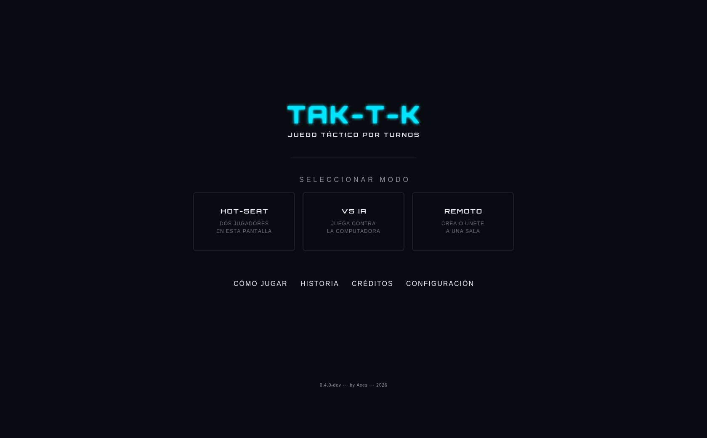
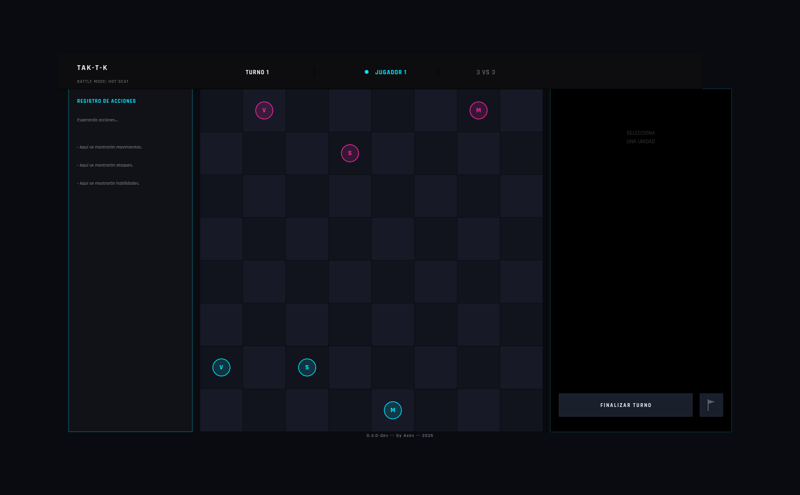
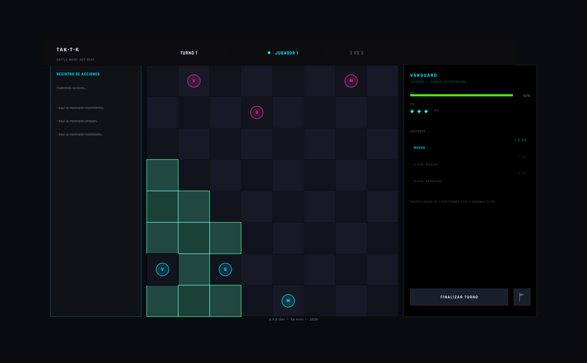
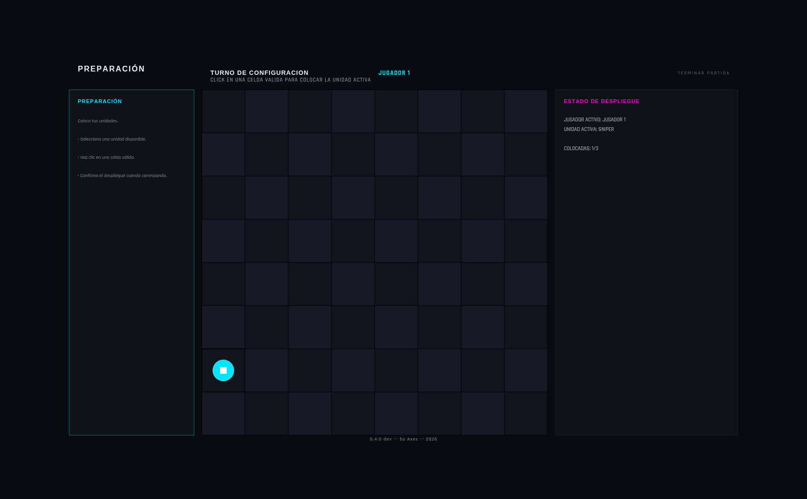
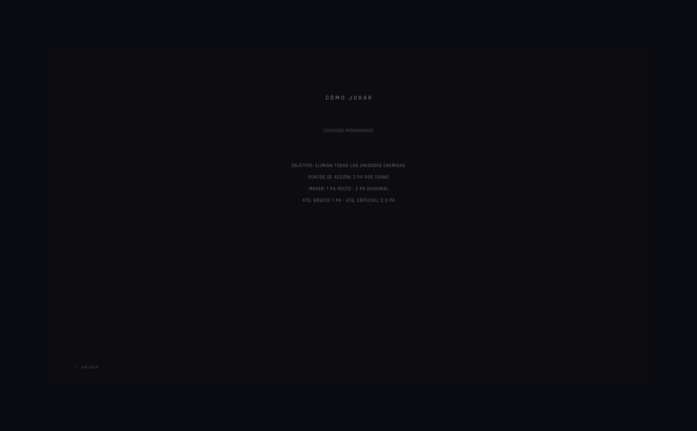
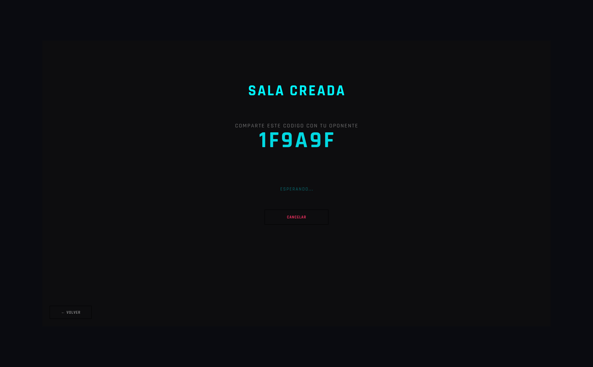
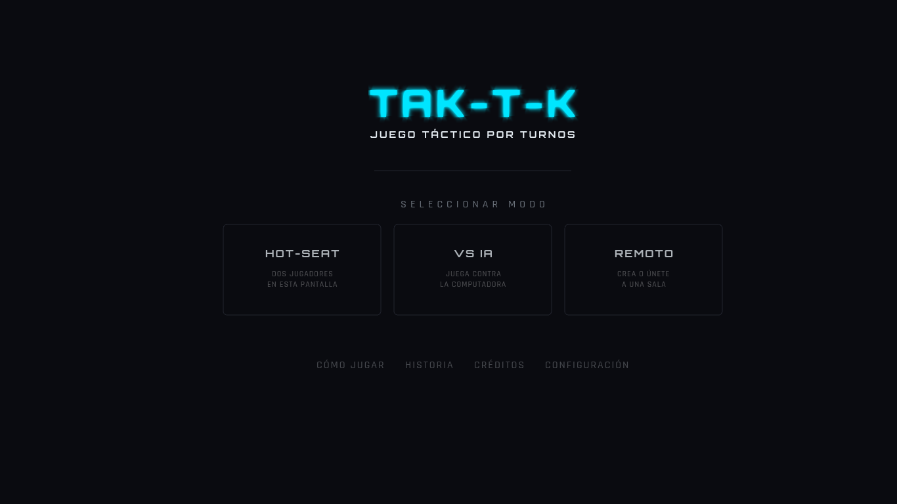
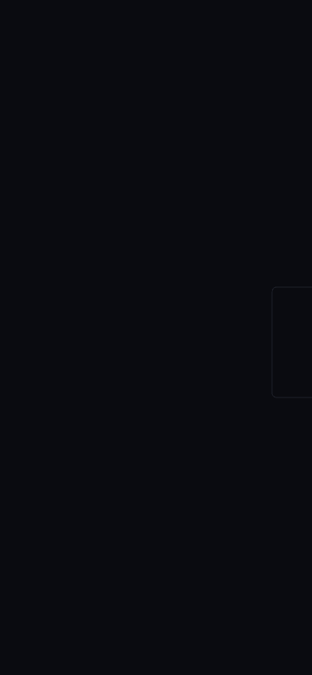

# Análisis de TAK-T-K

Informe de solo lectura para el rediseño. No cambia reglas, escenas ni servidor. La versión revisada es `0.4.0-dev` en `main`, con la última release etiquetada en la documentación como `v0.3.1`.

Fecha de la revisión: 14 de noviembre de 2026.

## 1. Resumen

TAK-T-K es un táctico por turnos en el navegador, para dos personas en el mismo computador (hot-seat), contra una IA, o en línea por código de sala. El tablero es de 8×8. Cada bando despliega tres unidades —Vanguard, Sniper y Mystic— y gana quien elimina al otro.

El nombre sale de *táctica*. La identidad visual que ya se siente es neón sobre negro: cian para el jugador 1, magenta para el jugador 2, tipografías Orbitron / Rajdhani / Plus Jakarta Sans. La portada es lo más cerrado del producto. La partida todavía se lee como un prototipo con un marco de layout encima.

### Cómo se juega hoy

1. En preparación cada jugador pone sus tres unidades, en orden fijo Vanguard → Sniper → Mystic, en sus dos filas traseras. El jugador 1 usa las filas de abajo (`y` 6 y 7). El jugador 2 usa las de arriba (`y` 0 y 1). No se puede reubicar una ficha ya puesta.
2. El primer turno se sortea.
3. Cada unidad viva entra a su activación con hasta 3 puntos de acción (PA). Caminar en cruz cuesta 1 PA. La diagonal cuesta 2. Las fichas se bloquean entre sí, pero se puede cortar esquina.
4. El ataque básico y el especial dependen de la clase. Al quedarse una unidad en 0 PA se deselecciona. Si ninguna unidad del jugador activo tiene PA, el turno pasa solo.
5. La partida termina por eliminación o por rendición del jugador activo. No hay límite de turnos ni tablas.

| Unidad | HP | Básico | Especial |
| --- | --- | --- | --- |
| Vanguard | 12 | 3 de daño, adyacente en 8 direcciones, 1 PA | 5 de daño y empuje de 1 celda, 2 PA |
| Sniper | 7 | 2 de daño, línea ortogonal hasta 3, 1 PA | 6 de daño, línea hasta 4, 3 PA. Si ya se movió, no puede usarlo. Después del especial no puede moverse |
| Mystic | 9 | El texto dice golpe en área. El código pega a un solo objetivo adyacente, 2 de daño, 1 PA | 0 de daño y −2 PA al turno siguiente, alcance 2, 2 PA |

La IA del jugador 2 es codiciosa: ataca si puede, si no camina hacia el enemigo más cercano. No simula “mover y después pegar”, no evalúa riesgo y cobra el movimiento con una fórmula que ignora obstáculos.

### Stack

- Cliente: JavaScript, Phaser 3.90.0, Vite 5. El motor y Socket.IO **no están en `package.json`**. Se importan por CDN (`cdn.jsdelivr.net` y `cdn.socket.io`). El build de producción pesa ~94 KB y sigue dependiendo de esas dos URLs.
- Servidor: Node.js, Express 4 y Socket.IO 4, en `taktk-server/`. Valida setup, movimiento, ataque, fin de turno y rendición reutilizando los sistemas del cliente.
- Sin TypeScript, sin lint, sin tests, sin CI de build. El único workflow de GitHub valida a mano que el changelog exista.

### Estructura

```text
TAK-T-K/
├── taktk-client/          Vite + Phaser
│   └── src/
│       ├── main.js        arranque del canvas 1440×810
│       ├── config.js      medidas, colores, fichas, filas de despliegue
│       ├── gameState.js   estado mutable de la partida local
│       ├── scenes/        portada, preparación, batalla, lobby y 4 pantallas huecas
│       ├── systems/       turno, movimiento, combate, IA
│       ├── entities/      Unit
│       └── ui/            HUD, layout desktop, overlay F2, glifos
├── taktk-server/          Express + Socket.IO
│   └── src/               server.js, RoomManager.js, GameValidator.js
├── run-dev.sh             cliente y servidor juntos
├── PENDIENTES.md          plan de UI desktop ya en curso
├── UI_SCENES_BACKLOG.md
└── PLAN-STAGING.md
```

`BattleScene.js` tiene 1191 líneas. `HUD.js`, 584. `SetupScene.js`, 511. `LobbyScene.js`, 454. Ahí vive casi toda la experiencia. Los sistemas de reglas son chicos y legibles, y esa separación es el mejor cimiento del repo.

### Cómo se ejecuta

Con Node instalado:

```bash
./run-dev.sh
```

Eso levanta el servidor en `http://127.0.0.1:3000` y el cliente en `http://127.0.0.1:5173`. También se puede entrar solo al cliente con `npm install` y `npm run dev` dentro de `taktk-client`. El modo remoto necesita el servidor, o la variable `VITE_SERVER_URL`.

Staging público, según el README: cliente en `https://tak-t-k.vercel.app` y servidor en `https://tak-t-k.onrender.com`. En esta revisión ambos respondieron. `/health` del servidor devolvió `{"ok":true,"service":"tak-t-k-server"}` después de unos 22 segundos de arranque en frío.

## 2. Estado actual

### Qué sí funciona

Se compiló el cliente (`npm run build` en Vite 5.4.21, sin errores) y `node --check` pasó en todo el JavaScript del cliente y del servidor. No hay script de lint ni de tests: no se pudo correr esa parte porque no existe.

En el navegador, con el cliente y el servidor locales:

- La portada carga, Phaser 3.90.0 arranca en WebGL y las tres tarjetas se ven.
- Hot-seat: se colocan las seis unidades y se entra a la batalla. Al seleccionar un Vanguard propio aparecen el rango de movimiento, la vida, los PA y las acciones.
- Remoto: se crea una sala y aparece un código de 6 caracteres. Con dos clientes Socket.IO, crear sala, unirse, desplegar, rechazar un fin de turno ajeno, rechazar un movimiento ilegal y aceptar un paso ortogonal de 1 PA funcionó.
- El servidor de staging sigue vivo.







### Lo que se siente al jugar

La portada tiene aire, marca y un glow que ya parece un juego. Desde preparación hacia abajo la densidad cae. El tablero es enorme y las unidades son un círculo fino con una letra. El panel izquierdo dice “registro de acciones” y se queda en el placeholder “Esperando acciones…”, aunque `gameState.log` sí se llena en local. El panel derecho, hasta que hay selección, es un bloque negro con “SELECCIONA UNA UNIDAD”. El footer mide 18 px y el texto completo es un enlace a GitHub.

En preparación las filas válidas no se marcan. Un clic fuera de zona no dice nada. El texto lateral pide “selecciona una unidad disponible”, pero el orden es fijo y no hay selección. Tampoco hay botón de confirmar en hot-seat: al poner la tercera ficha del jugador 2 la batalla parte sola. El glifo de preparación (cuadrado, círculo, rombo) no es la letra que después aparece en batalla.



“Cómo jugar” anuncia “CONTENIDO PRÓXIMAMENTE” y, debajo, cuatro líneas. Esas líneas dicen “3 PA por turno”. En el código los 3 PA son de cada unidad, no una reserva compartida. No explica clases, empuje, drenaje, filas de despliegue ni que una ficha mal puesta se queda ahí. Historia, créditos y configuración son la misma pantalla casi vacía. Créditos nombra a Gino y a Claude; el README también nombra a GPT y Copilot; el footer dice Axes.



El lobby funciona y se ve más simple que la batalla: no usa el layout de cuatro zonas, no muestra si el servidor está conectado y el código no se puede copiar con un botón.



No hay audio. Phaser reporta Web Audio disponible y el juego no reproduce nada. No hay animación de movimiento, número de daño, golpe ni muerte: la ficha aparece en la celda nueva o desaparece al redibujar.

### Bugs y desajustes de reglas

Comprobado ejecutando los sistemas, no solo leyéndolos:

1. **El básico del Mystic no es en área.** `UNIT_TEMPLATES` dice `shape: 'adjacentAoE'` y el HUD dice “GOLPE EN AREA ADYACENTE”. `resolveAttack` solo baja la vida del objetivo clickeado. Dos enemigos adyacentes: uno pasó de 7 a 5 HP y el otro se quedó en 12.
2. **El especial del Mystic no coincide con su ficha.** La config dice línea de alcance 2. El código acepta las 8 direcciones, no se detiene en la primera ficha y puede marcar a alguien detrás de otra unidad. El Sniper sí se detiene en el primer cuerpo.
3. **El movimiento sin costo precalculado cobra de menos si hay que rodear.** Una celda alcanzable con costo real 4 se cobró a 2 PA y la unidad igual aterrizó ahí. La batalla local pasa el costo del pathfinding y está bien. La IA llama `moveUnit` sin ese costo, y en la prueba eligió una celda de costo 4 que `getPathCost` cotiza en 2. La IA se teletransporta más barato que el humano.
4. **Se puede cortar esquina.** Con las dos celdas ortogonales ocupadas, la diagonal sigue siendo legal a 2 PA. Hay que decidir si eso es regla o agujero.
5. **“Tiene acciones” mira solo si queda PA.** `TurnSystem.activePlayerHasActions` es `ap > 0`. Una unidad encerrada, sin blanco y con 1 PA, no termina el turno sola. El jugador tiene que encontrar “Finalizar turno”.
6. **Turno y ronda están mezclados.** Cada activación de un jugador suma 1 a `turnNumber`. El HUD dice `TURNO 1` cuando mueve el primero y `TURNO 2` cuando le toca al otro. `PENDIENTES.md` ya marca esta duda. Conviene cerrarla antes de reescribir textos.
7. **Durante el turno de la IA el botón de fin de turno sigue vivo.** `endTurn()` no mira `inputLocked`. El HUD tampoco lo deshabilita. Un doble clic puede cortar el turno de la CPU mientras `AISystem.executeTurn()` sigue corriendo, y al salir la IA vuelve a pasar el turno. `tryEndTurnFromButton()` y `trySurrenderFromButton()` no los llama nadie. La instrucción de Copilot describe ese código muerto, no el botón real. El botón real siempre pide un segundo clic, y la confirmación se apaga a los 1,8 s.
8. **En remoto la selección se borra en cada acción.** El servidor deja `selectedUnitId` en `null` y no agrega la acción al log. El cliente reemplaza el estado completo. Después de un movimiento válido el probe recibió `selected: null` y `log: ["BATALLA INICIADA"]`. En local la ficha sigue seleccionada. En línea hay que volver a tomarla para cada PA.
9. **Los apodos no llegan a la partida.** El lobby los pide y el servidor los guarda (recorte a 24 caracteres, sin pasar a mayúsculas ni filtrar). Preparación y batalla siguen diciendo “JUGADOR 1”. El probe devolvió el apodo `gino<script>` tal cual al oponente. En texto de Phaser no es un XSS; si ese string cae en HTML más adelante, sí.
10. **La rendición remota guarda al ganador como `'p1'` / `'p2'`.** En local el ganador es el número `1` o `2`. La batalla remota lo traduce y la pantalla de victoria aguanta. `checkVictory` del servidor no ve la rendición, porque las fichas siguen vivas; se salva porque después usa el string. Es frágil.
11. **El rematch dura 5 segundos** desde el primer “jugar de nuevo”, no desde que termina la partida. Hay que ver el resultado, clickear y que el otro alcance a confirmar. Si no, la sala se cierra.
12. **No hay reconexión.** Si se cae el jugador 1, la sala se borra. Si se cae el jugador 2, la sala vuelve a “esperando” y se tira la partida. En el plan gratuito de Render un cold start o un corte de red termina la mesa.
13. **Las salas no expiran y no hay límite de creación.** Un cliente puede abrir salas sin parar. El id usa `Math.random`, 6 caracteres de un alfabeto de 36. Alcanza para una mesa entre amigos; no alcanza como control.
14. **El changelog está roto.** `taktk-client/CHANGELOG.md` abre con marcadores `<<<<<<< HEAD`. El workflow solo comprueba que el archivo no esté vacío y que exista `## [Unreleased]`, así que esto no falla en CI.
15. **El README describe otro layout.** Habla de canvas 1366×768 y celdas de 64 px. El juego es 1440×810 y celdas de 90. `PENDIENTES.md` sí está al día. Quien rediseñe desde el README va a partir de medidas viejas.
16. **Favicon 404** en el dev server. Menor, y se ve en la pestaña.

### Pantallas chicas

El canvas es fijo: 1440×810, `Phaser.Scale.NONE`, sin escala. `PENDIENTES.md` dice que un viewport más chico debe hacer scroll. `index.html` pone `overflow: hidden` en `html` y `body`. Medido en Chrome:

| Viewport | Qué pasa |
| --- | --- |
| 1680×1040 | El canvas cabe y se centra. La portada se ve entera. |
| 1366×768 | El canvas queda en `left: 0, top: 0`. No hay scroll (`canScroll: false`). Se pierden los 74 px de la derecha y los 42 px de abajo. En la portada el footer desaparece. En batalla la última fila queda cortada. |
| 390×844 | Se ve un recorte negro y el borde de una tarjeta. El título, que vive al centro del canvas de 1440, queda fuera. |





`TOUCH_TARGETS` está declarado y no lo usa la interacción. El layout móvil apaisado está nombrado en `layout.js` y en los pendientes, y no existe.

### Calidad del código y deuda

Lo que conviene conservar:

- Reglas en `MovementSystem`, `CombatSystem`, `TurnSystem` y `Unit`, separadas de Phaser.
- El servidor reutiliza esos sistemas en vez de reescribir el combate.
- `config.js` como ficha de HP, PA, daño y filas.
- `createDesktopTacticalLayout()` y el overlay F2. Es una herramienta de verdad para ordenar la UI.
- `run-dev.sh` con limpieza de procesos.
- Convención de commits y archivo `VERSION`.

Lo que pesa:

- Las escenas construyen toda la UI a mano, con colores repetidos fuera de `COLORS` y coordenadas mágicas. El botón “volver” está copiado en cuatro escenas.
- `shape` de los ataques no lo lee nadie. El combate hace `if (unit.key === 'VANGUARD')`. Agregar una clase obliga a tocar el sistema, el HUD, la IA y el validador.
- `startTurn` está duplicado en `server.js` y `GameValidator.js`.
- El id de `Unit` es un contador de módulo. En un proceso largo los id no vuelven a empezar. Hoy no choca; ata el modelo a un global.
- `main.js` deja un `console.table` de diagnóstico a los 250 ms, también en producción.
- El servidor importa `../../taktk-client/src/...`. Funciona si el deploy clona el repo completo: el staging de Render está arriba, así que hoy arranca. Si el root de build pasa a ser solo `taktk-server/`, el proceso no encuentra las reglas. Cliente y servidor no se pueden versionar por separado.
- Phaser y el cliente de red viven en un CDN. Sin red, o si jsDelivr cambia, el build “exitoso” no abre el juego.
- No hay licencia. El README dice que la base es libre para forkear. Sin archivo `LICENSE`, el default es “todos los derechos reservados”. Si la idea es que otros deriven juegos, hay que elegir una licencia de forma explícita.
- Las instrucciones de Copilot (`taktk-client/.github/copilot-instructions.md`) todavía apuntan a `server/src/` y omiten `LobbyScene` en el orden real de escenas.

### Seguridad, en el tamaño de este juego

No hay cuentas ni datos sensibles. El riesgo real es de abuso de la mesa y de integridad de la partida:

- Cualquiera con el código entra. No hay anfitrión, kick ni cierre voluntario de sala más allá de desconectarse.
- No hay rate limit. Crear salas llena la memoria del proceso.
- CORS acepta requests sin `Origin`. El navegador manda origen; un cliente que no es navegador no.
- Las acciones de juego sí las revisa `GameValidator` antes de aplicarlas. Eso está bien y hay que no perderlo en el rediseño: el cliente remoto no debe volver a ser la autoridad.
- `npm audit` marca avisos en dependencias de Vite (solo desarrollo) y en la cadena de Express / Socket.IO / `proxy-addr`. El servidor no configura `trust proxy`. Conviene una pasada de actualización, no tratar esos avisos como el bug de la partida.

### Balance, corto

En un tablero de 8×8 el Vanguard mata al Sniper en un turno si lo alcanza: especial 5 + básico 3 = 8, y el Sniper tiene 7. El especial del Sniper pega 6 y no elimina a nadie de un tiro, y se gasta los 3 PA. El Mystic no tiene el área que promete y su especial no hace daño, así que la IA casi siempre prefiere el básico contra el HP más bajo. El despliegue de la IA es al azar en sus dos filas. No hay terreno, cobertura, objetivo secundario ni reloj. Dos jugadores que solo pasan turno pueden quedarse ahí.

## 3. Propuestas, por impacto y esfuerzo

Escala usada: impacto en la partida que alguien juega esta semana, y esfuerzo sobre el código que ya existe. “Bajo” cabe en un cambio acotado. “Alto” toca varias escenas o el protocolo.

### Diseño visual, UI y UX

| Cambio | Impacto | Esfuerzo |
| --- | --- | --- |
| Marcar las dos filas de despliegue, la celda ilegal y la ficha que toca poner. Alinear el texto del panel con el orden fijo. | Alto | Bajo |
| Mostrar `gameState.log` en el sidebar izquierdo, con las últimas 8 líneas de verdad. Sacar el placeholder. | Alto | Bajo |
| Un solo lenguaje visual de ficha en preparación y batalla. Hasta que existan sprites, la letra sobre el círculo de color alcanza. | Alto | Bajo |
| Coordenadas o al menos un índice de fila, para que “fila válida” se pueda decir en voz alta. | Medio | Bajo |
| Deshacer la última ficha, o clickear una ficha propia para levantarla, antes de confirmar. | Alto | Medio |
| Reescribir “Cómo jugar” con las tres clases, el costo real de PA y el despliegue. Borrar “próximamente” de lo que ya está escrito. | Alto | Bajo |
| Contraste de textos auxiliares. Hoy hay grises en `rgba(255,255,255,0.25)` sobre `#0a0b10`. Subir cuerpo de panel a un gris que se lea sin acercarse. | Alto | Bajo |
| Nombre del modo en español en batalla (`HOT-SEAT`, `VS IA`, `REMOTO`) y apodo en vez de solo “JUGADOR 1”. | Medio | Bajo |
| Botón de rendición con palabra, no solo la bandera. Confirmación que no se esfuma a los 1,8 s, o un diálogo igual al de salir de preparación. | Medio | Bajo |
| Vaciar los paneles que no tienen contenido en vez de estirar cajas negras. La portada ya hace esto. Preparación y lobby todavía no. | Medio | Medio |
| Sistema de temas (neón, alto contraste, medieval, cuaderno) **después** de que los textos y las zonas estén estables. Si no, se tematiza un placeholder. | Medio, más adelante | Alto |

La portada ya puede quedarse quieta un ciclo. El margen de mejora grande está en preparación y en el HUD de batalla, que es lo que `UI_SCENES_BACKLOG.md` tiene como siguiente tarea. Ese orden sigue siendo bueno.

### Jugabilidad

| Cambio | Impacto | Esfuerzo |
| --- | --- | --- |
| Decidir el Mystic y escribirlo en un solo lugar: o el básico pega a todos los adyacentes, o el texto y la config dejan de decir área. | Alto | Bajo si se corrige el texto; medio si se implementa el área |
| Hacer que la IA pague `match.cost` del pathfinding. Es un argumento en una llamada. | Alto para quien juegue vs IA | Bajo |
| Bloquear fin de turno y rendición mientras `inputLocked` o no es el turno local. Borrar o cablear `tryEndTurnFromButton`. | Alto | Bajo |
| En remoto, conservar la unidad seleccionada si sigue viva y es tuya, y anexar la última acción al log de los dos clientes. | Alto | Medio |
| Elegir “ronda” (los dos jugaron) o “turno” (una activación) y usarlo en el HUD. | Medio | Bajo |
| Pasar el turno solo cuando no queda ninguna acción legal, no cuando `ap > 0`. | Medio | Medio |
| Intersticial de un toque entre jugadores en hot-seat, para entregar el computador. La información ya es perfecta; el valor es social, no de reglas. | Medio | Bajo |
| Rematch de 20–30 s, con el reloj visible desde el final, y botón “copiar código” en el lobby. | Alto en mesas reales | Bajo |
| Reconexión corta (mismo socket id de sala, estado autoritativo ya está en el servidor). | Alto | Alto |
| IA que mire “mover y luego atacar”, que no gaste todos los PA en acercarse, y un despliegue con el Sniper atrás. Un solo nivel está bien hasta que las reglas estén quietas. | Medio | Medio |
| Un objetivo además de la eliminación, o un máximo de rondas con desempate por HP restante, para que pasar turno no sea infinito. | Medio | Medio |
| Terreno, cobertura y más clases: después de que las tres actuales hagan lo que dicen. | Alto a futuro | Alto |

### Arquitectura y código

| Cambio | Impacto | Esfuerzo |
| --- | --- | --- |
| Tests de reglas sin Phaser: Mystic, costo con obstáculo, Sniper tras moverse, rendición, filas de setup. El probe de esta revisión ya los distingue. | Alto | Bajo |
| Un paquete `taktk-rules` importado por cliente y servidor. Sacarlo del import relativo `../../taktk-client`. | Alto | Medio |
| Phaser y `socket.io-client` como dependencias npm, con versión fija. El CDN queda solo si se decide a propósito. | Alto | Bajo |
| Resolver el conflicto del changelog y hacer que el workflow falle si hay marcadores `<<<<<<<`. | Medio | Bajo |
| Actualizar README a 1440×810 y a la estructura con `taktk-server/`. | Medio | Bajo |
| ESLint mínimo y un job que haga `npm run build` del cliente y `node --check` del servidor. | Medio | Bajo |
| Partir `BattleScene` en tablero, input, resultado y red cuando se toque game feel. No antes: un refactor sin comportamiento nuevo se come el ciclo 0.4. | Medio | Alto |
| Leer `shape` desde la config en `CombatSystem`, para que una clase nueva no sea una cadena de `if`. | Medio | Medio |
| Licencia explícita, si el repo sigue invitándote a forkarlo. | Medio para la comunidad | Bajo |

### Rendimiento

El tablero de 64 celdas no es un problema de CPU. El pathfinding ordena la cola en cada paso y en 8×8 no se nota. Lo que sí se ve:

- Cada hover destruye y recrea todos los overlays. En este tamaño está bien. Si aparecen animaciones, conviene actualizar alpha en vez de recrear.
- `resolution: 1` evita el desenfoque por escala decimal y deja el canvas suave en pantallas retina. Cuando exista escala entera (2× en DPR alto, 1× en el resto), se gana nitidez sin volver al bug de centrado doble.
- El `console.table` y el glow con preFX de la portada son ruido menor. El glow puede respetar `prefers-reduced-motion`.

### Accesibilidad

| Cambio | Impacto | Esfuerzo |
| --- | --- | --- |
| Subir contraste de ayuda, footer y “sin selección”. | Alto | Bajo |
| No usar solo color: la letra de clase ya ayuda. Mantenerla cuando lleguen sprites. | Alto | Bajo |
| Foco visible en tarjetas y botones. Hoy el teclado solo sirve para Escape y para el input del lobby. | Medio | Medio |
| Atajos simples en batalla: flechas o números para acción, Enter para confirmar celda. | Medio | Medio |
| Reducir glitch y pulsos si el sistema pide menos movimiento. | Medio | Bajo |
| El segundo clic de 1,8 s es fácil de perder con motor fino o con lector. Un diálogo estable es más claro para todo el mundo. | Medio | Bajo |
| Texto del HUD en el DOM, aunque el tablero siga en canvas, el día que se quiera lector de pantalla. No es el primer paso. | Medio a futuro | Alto |

### Responsive y celular

No escalar el 1440×810 para que “quepa”. En un teléfono vertical el tablero de 90 px deja de ser jugable aunque se encoja, y el HUD lateral no tiene dónde vivir.

El camino que ya está anotado en `PENDIENTES.md` es el correcto, y conviene no adelantarlo:

1. En notebook, permitir scroll real o bajar el marco a algo que entre en 1366×768 sin cortar la última fila. Eso desbloquea a quien juega en un computador común en Chile antes de diseñar el celular.
2. Recién ahí, `createMobileLandscapeTacticalLayout()`: tablero al centro, ficha y acciones abajo o en un sheet, orientación vertical bloqueada con un mensaje.
3. Áreas táctiles de 44 px como mínimo. La celda de 90 ya cumple en desktop; en un canvas escalado hay que volver a medir.


### Audio

Hoy es silencio total, y la configuración no tiene perillas. Un primer paso chico, sin producción musical:

- clic de UI, paso, impacto, especial, muerte y fin de turno;
- un loop muy bajo en batalla, con mute por defecto hasta que alguien lo pida, o con mute recordado en `localStorage`;
- el mute en la escena de configuración, que hoy dice “próximamente”.

El impacto en la sensación de juego es alto. El esfuerzo es medio porque hay que enganchar eventos que hoy no existen como “la ficha se movió” fuera del redibujado.

### Despliegue

| Cambio | Impacto | Esfuerzo |
| --- | --- | --- |
| Documentar la URL real (`onrender` + `vercel`) en `DEPLOY.md`, que todavía habla de Railway como camino principal. | Medio | Bajo |
| Healthcheck ya existe. Falta que el cliente diga “conectando / servidor dormido, puede tardar un minuto” en vez de fallar en silencio si Render está frío. | Alto | Bajo |
| Build del cliente que no dependa del CDN, para que Vercel sirva un artefacto completo. | Alto | Bajo |
| Sala con TTL y tope de salas por proceso, antes de abrir el staging a más gente. | Alto | Medio |
| No prometer multijugador estable en el plan gratuito sin reconexión: el cold start de ~20–60 s corta la primera impresión. | Alto como expectativa | Bajo de explicar; alto de resolver con un plan siempre encendido |

## 4. Plan de rediseño en fases cortas

Cada fase termina en algo jugable. No se abre la siguiente para “dejar la UI linda” si la anterior dejó una regla mentirosa. El ciclo `0.4.0-dev` puede cerrarse en las fases 1 a 3. Temas, celular y profundidad quedan para 0.5 o para cuando 0.4 se etiquete.

### Fase 0 — Congelar lo que es verdad

Sin cambio de sensación de juego.

- Arreglar el conflicto del changelog.
- README, instrucciones de Copilot y `DEPLOY.md` con las medidas y las carpetas reales.
- Tests de las reglas que este informe ya vio fallar: área del Mystic, costo con obstáculo, especial del Sniper después de moverse, filas de setup, rendición.
- Decidir la licencia en una línea, o sacar del README la invitación a reutilizar la base.

Criterio: un test rojo documenta el Mystic y el costo de la IA, y la documentación no contradice `config.js`.

### Fase 1 — Que se entienda la partida que ya existe

Es el corazón de `UI-SCENES-02` y `UI-SCENES-03`, con prioridad en información y no en adorno.

- Zona de despliegue visible, ficha activa clara, deshacer última colocación.
- Mismo símbolo en preparación y batalla.
- Log real en el sidebar.
- “Cómo jugar” útil, en el contraste de la portada.
- Textos de modo en español.
- Botones de fin de turno y rendición inertes cuando no toca actuar.

Criterio: una persona que no leyó el código despliega sin preguntar cuáles son las filas, y después de un ataque lee qué pasó sin abrir la consola.

### Fase 2 — Local y remoto se sienten la misma partida

- Selección que sobrevive al `game:update`.
- Log de la última acción en el estado público.
- Apodos en el header.
- Copiar código, estado de conexión y aviso de cold start.
- Rematch con un plazo en el que dos humanos alcanzan a leer el resultado.
- Misma forma de ganador (`1` / `2` o `p1` / `p2`) en todo el protocolo.

Criterio: dos navegadores completan despliegue, tres acciones y un rematch sin reseleccionar a ciegas ni perder la sala a los 5 s.

### Fase 3 — Las tres clases hacen lo que dicen

Una decisión de diseño, no un parche silencioso:

- Mystic: área de verdad, o texto y config honestos.
- Especial del Mystic: línea ortogonal que se corta, o la ficha actualizada a “cualquier dirección, atraviesa”.
- IA cobra el costo del camino y deja de caminar “gratis” alrededor de un cuerpo.
- Cerrar turno y ronda en el HUD.
- Corte de esquina: se deja escrito como regla o se cierra.

Criterio: el test de la fase 0 pasa, y el tutorial, el HUD y `CombatSystem` cuentan la misma historia.

### Fase 4 — Sensación de juego, todavía con círculos

Sin sprites nuevos todavía. Con los eventos de la fase 3:

- La ficha se desliza a la celda. El golpe parpadea. El daño se lee un segundo sobre el blanco. La muerte no es un `clear` mudo.
- Seis sonidos cortos y un mute que se recuerda.
- `prefers-reduced-motion` apaga glitch y desliz.

Criterio: en un video de 20 segundos se distingue mover, pegar y eliminar sin mirar el log.

### Fase 5 — Cimiento para seguir creciendo

Aquí sí conviene el refactor, porque las fases anteriores ya fijaron el comportamiento.

- `taktk-rules` compartido. El servidor deja de importar el árbol del cliente.
- Phaser y Socket.IO en el `package.json`.
- CI: test de reglas, build del cliente, arranque del servidor.
- Recién entonces, partir `BattleScene` si sigue doliendo tocarla.
- Tema neón extraído a tokens, sin segundo tema todavía.

Criterio: se puede publicar el cliente sin CDN y el servidor sin tener el fuente del cliente al lado.

### Fase 6 — Notebook y celular apaisado

- Que 1366×768 muestre la última fila y el botón de fin de turno, con scroll o con un marco que entre.
- Layout apaisado, orientación vertical bloqueada con una frase, no con un canvas cortado.
- Probar el dedo en despliegue, movimiento y ataque.

Criterio: en un notebook de 1366×768 se juega una partida hot-seat completa. En un celular vertical se ve el pedido de girar, no un cuarto de tarjeta.

### Fase 7 — Más juego, cuando la base no mienta

En este orden, cada una como su propio ciclo:

1. Tope de rondas y desempate, para cerrar partidas eternas.
2. IA de un nivel que amenace de verdad, usando las partidas solo si más adelante hay replay. Hoy no hay historial estructurado: el sidebar es el lugar natural para empezar a guardarlo.
3. Un cuarto modo chico (escenario o handicap), no tres temas visuales a la vez.
4. Sprites en `public/assets/sprites/units`, que ya tiene la carpeta vacía.
5. Temas extra, cuando el neón sea tokens y no colores sueltos en cada escena.

## Qué no haría en el primer ciclo

- Reescribir el juego en otro motor. Phaser alcanza, y el problema no es el motor.
- Responsive genérico con `Scale.FIT` sobre el layout de escritorio. Ya se abandonó a propósito por el desenfoque, y volver ahí tapa la última fila en vez de rediseñarla.
- Multijugador con cuentas, ranking o base de datos antes de reconexión y de un log visible.
- Más clases o terreno mientras el Mystic diga una cosa y haga otra.
- Un sistema de temas con cuatro pieles antes de vaciar los paneles placeholder.

## Evidencia de esta revisión

- `npm run build` en `taktk-client`: correcto.
- `node --check` en el JavaScript de cliente y servidor: correcto.
- Lint y tests: no hay scripts.
- Partida hot-seat abierta en Chrome hasta la batalla, más lobby local con código de sala.
- Protocolo remoto con dos sockets contra el servidor local: alta, setup, rechazo de turno ajeno, rechazo de movimiento ilegal, movimiento legal de 1 PA.
- Script de reglas sobre `CombatSystem`, `MovementSystem`, `AISystem` y `GameValidator`.
- `GET https://tak-t-k.onrender.com/health` y el cliente de Vercel: ambos respondieron.
- Capturas en `docs/capturas/`.
